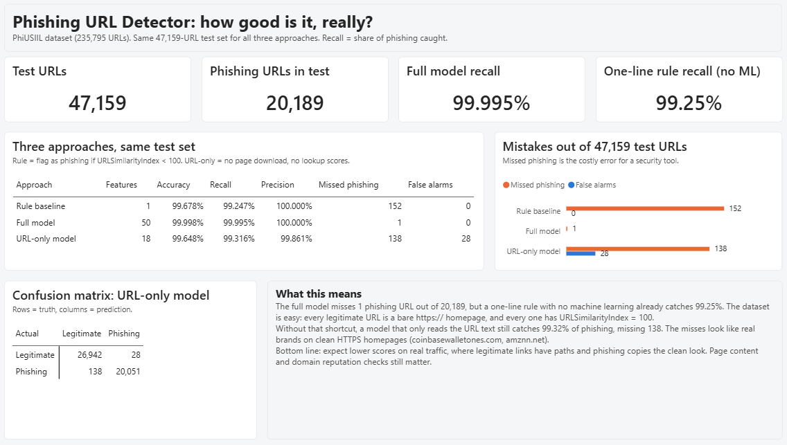
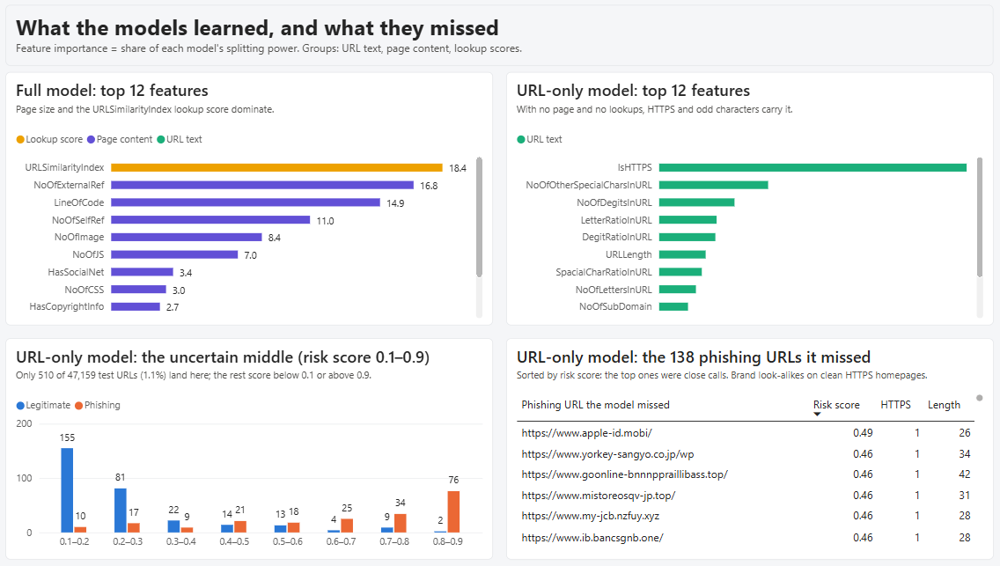

# Phishing URL Detector

A machine learning pipeline that classifies phishing URLs using the PhiUSIIL dataset (235,795 URLs), with an honest look at **why the scores are so high** and what's left once you remove the dataset's shortcuts. It combines data analytics, cybersecurity and machine learning, and ends in a Power BI dashboard.

**[View Power BI Dashboard](https://app.powerbi.com/view?r=eyJrIjoiMzkzYmFmZmMtYTRhYy00YTUxLTg2MjQtZjQzOWU1OGQ3ODk0IiwidCI6IjYwOTU2ODg0LTEwYWQtNDBmYS04NjNkLTRmMzJjMWUzYTM3YSIsImMiOjF9)**

---

## Key results

Three approaches, scored on the same 47,159-URL test set (20,189 phishing, 26,970 legitimate):

| Approach | Features | Recall (phishing caught) | Missed phishing | False alarms |
|---|---|---|---|---|
| **One-line rule:** flag if `URLSimilarityIndex < 100` | 1 | 99.25% | 152 | 0 |
| **Random Forest, all features** | 50 | 99.995% | 1 | 0 |
| **Random Forest, URL text only** | 18 | 99.32% | 138 | 28 |

- **The full model is near-perfect, but so is a rule with no machine learning.** In this dataset, every legitimate URL is a bare `https://` homepage and every one scores exactly 100 on `URLSimilarityIndex`. The classes are almost separable by construction.
- **A URL-only model is the more realistic test.** It reads only the URL string: no page download, no lookup scores. It still catches 99.3% of phishing.
- **What gets missed is telling:** `coinbasewalletones.com`, `amznn.net`, `shopeinnovationt.com`. These are brand look-alikes on clean HTTPS homepages, exactly the pattern attackers can copy.

---

## Dashboard

**Page 1: how good is it, really?** Three approaches compared on the same test set.


**Page 2: what the models learned, and what they missed.**


---

## Dataset

**[PhiUSIIL Phishing URL Dataset](https://archive.ics.uci.edu/dataset/967/phiusiil+phishing+url+dataset)** (UCI; Prasad & Chandra, *Computers & Security*, 2023)
- 235,795 URLs: **134,850 legitimate (57.2%)** and **100,945 phishing (42.8%)**
- 50 numeric features from the URL and the downloaded page; no missing values
- **Label convention: `label = 1` means legitimate and `0` means phishing.** The scripts create `is_phishing = 1 - label` and check the class counts against UCI's published numbers.

The dataset isn't in the repo (57 MB). Download it from UCI and save it as `data/PhiUSIIL_Phishing_URL_Dataset.csv`.

---

## What separates phishing from legitimate URLs (Step 2)

| Signal | Phishing | Legitimate |
|---|---|---|
| Uses HTTPS | 49% | 100% |
| Links to social networks | 0.5% | 79.5% |
| Has copyright info | 5.7% | 80.8% |
| Has a page description | 4.4% | 73.7% |
| Median lines of page code | 12 | 1,105 |
| Median external links | 0 | 46 |
| `URLSimilarityIndex` = 100 | 0.8% | 100% |

**Security takeaway:** half of phishing URLs here use HTTPS, so the padlock doesn't mean safe. What gives phishing away is that it's *thin*: throwaway pages with little code, no footer, no social links and no real content. Legitimate sites look built-out.

---

## Approach

| Step | Script | What it does |
|---|---|---|
| 1 | `step1_explore.py` | Load, check missing values, confirm the label meaning against UCI's counts, spot-check URLs |
| 2 | `step2_features.py` | Correlations and per-class comparisons, with every percentage computed from the data |
| 3 | `step3_model.py` | Train two Random Forests (100 trees, max depth 20) on one stratified 80/20 split: all 50 features, and 18 URL-text features |
| 4 | `step4_evaluate.py` | Score the rule baseline and both models: confusion matrices, recall, precision, and the actual URLs each one missed |
| 5 | `step5_export.py` | Export dashboard CSVs to `exports/` |

**Why recall leads:** a missed phishing URL (false negative) can mean stolen credentials. A false alarm blocks a real site, which is annoying but recoverable.

**Why a rule baseline:** a near-perfect score means little until you know what a trivial approach gets. Here, one `if` statement gets 99.25% recall. That's the context every other number needs.

**URL-only features** (18): length counts, letter/digit/special-character counts and ratios, subdomains, obfuscation, IP-as-domain and HTTPS. It deliberately leaves out `URLSimilarityIndex`, `URLCharProb`, `TLDLegitimateProb` and `CharContinuationRate`, which are scores computed against reference lists, plus all page-content features.

---

## Limitations

- **The dataset is easier than real traffic.** All legitimate URLs are homepages. Real users click deep links (`/login`, `/account?id=...`), so URL-based models will raise more false alarms in practice.
- **Random split, no time dimension.** Phishing campaigns change quickly. A time-based split, training on older URLs and testing on newer ones, would be a tougher and fairer test.
- **Page-content features need the page.** The full model must download a page before it can score it. That's slower, and attackers can serve different content to scanners.
- **Precision depends on the mix.** The test set is 43% phishing. In real email or web traffic, phishing is a tiny fraction, so even a 0.1% false alarm rate means many blocked legitimate links.

---

## Correction note

An earlier version of this project mapped `label = 1` to *phishing*. PhiUSIIL uses `1` for **legitimate**, so the class names, the per-class findings (HTTPS, social links, URL length) and the false-negative/false-positive counts were reversed. Every script now builds `is_phishing = 1 - label` and checks the counts against UCI's published numbers, and all results above come from the corrected pipeline.

---

## Setup

```bash
pip install pandas scikit-learn
# download the dataset to data/PhiUSIIL_Phishing_URL_Dataset.csv, then from the repo root:
python scripts/step1_explore.py
python scripts/step2_features.py
python scripts/step3_model.py
python scripts/step4_evaluate.py
python scripts/step5_export.py
```

**Power BI:** open `powerbi/PhishingDetector.pbip` in Power BI Desktop. If the repo isn't at `C:\Users\wally\phishing-detector`, go to **Transform data → Edit parameters** and set **DataFolder** to your `exports\` folder (with a trailing `\`), then click **Refresh**.

---

## Project structure

```
phishing-detector/
├── data/                  dataset goes here (gitignored)
├── scripts/               step1 … step5
├── exports/               dashboard CSVs (models.pkl is gitignored)
├── powerbi/               PBIP project: semantic model (TMDL) + report (PBIR)
└── README.md
```

## Tech stack

Python (pandas, scikit-learn) · Random Forest · Power BI (PBIP, DAX) · PhiUSIIL dataset

---

## About

Built by a Business IT student at Virginia Tech as a portfolio project combining data analytics and cybersecurity. The focus is evaluating a detector the way a security team would: by what it misses, against an honest baseline.
